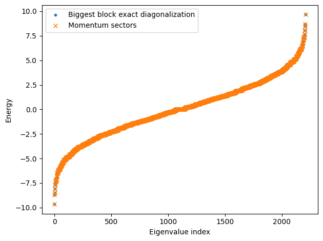
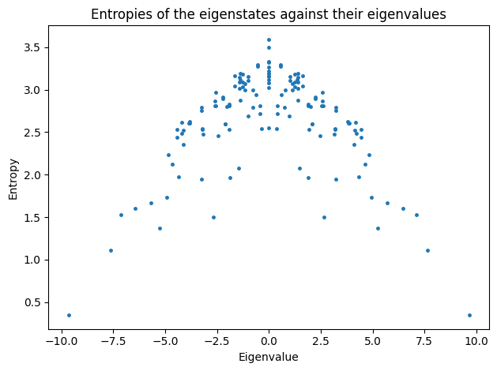
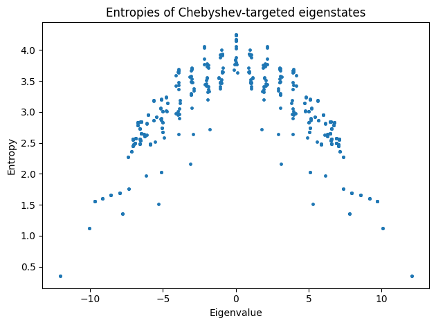

# Quantum Many-Body Scars in the PXP Model

**Polynomial-filter diagonalization, translation symmetry, and entanglement analysis**

This repository contains the numerical work, report, and presentation for a computational condensed-matter project at the University of Bonn. It investigates atypical many-body eigenstates (quantum scars) in the one-dimensional PXP model, using exact diagonalization as a benchmark and Chebyshev polynomial filtering to target selected eigenstates.

## Physical model

The PXP Hamiltonian describes constrained spin-flip dynamics on a one-dimensional chain, motivated by the Rydberg blockade:

$$
H = \sum_{i=0}^{L-1} P_{i-1} X_i P_{i+1},
\qquad P_i = |0\rangle_i\langle 0|,
$$

with site indices understood modulo $L$ (**periodic boundary conditions**). The project works with the connected component of the computational-basis Hamiltonian that satisfies the nearest-neighbor blockade constraint.

## Numerical workflow

1. **Sparse Hamiltonian and constrained basis:** construct the PXP Hamiltonian and identify its largest connected component from the basis-state adjacency graph.
2. **Exact diagonalization:** calculate the spectrum of the constrained Hamiltonian for $L=16$ as a benchmark.
3. **Translation symmetry:** build momentum-sector bases, diagonalize the sectors independently, and compare their combined spectrum with the benchmark.
4. **Entanglement analysis:** embed eigenvectors in the full computational basis and calculate bipartite entanglement entropy using singular values, focusing on the $k=0$ sector.
5. **Chebyshev polynomial filtering:** target eigenstates near selected energies without computing the entire spectrum; apply the method up to $L=20$.

The report discusses both the results and the computational bottleneck associated with first constructing the full basis before selecting the constrained momentum sector.

## Selected figures

**Momentum-sector spectrum comparison**



**Entanglement entropy in the momentum-zero sector**



**Chebyshev-filtered results for L = 20**



## Repository structure

```text
.
├── main.ipynb                    # Research notebook: tasks 1–5
├── src/
│   ├── __init__.py
│   └── pxp.py                    # Basis-state operations and PXP Hamiltonian
├── data/                         # Saved L=16 eigenvalues and eigenvectors
├── figures/                      # Plots used in the report and presentation
├── report/
│   ├── main.tex
│   ├── references.bib
│   └── project_06_scars_Ahmet-Berk-Kavruk.pdf
├── presentation/
│   ├── presentation.tex
│   └── presentation.pdf
└── requirements.txt
```

## Running the notebook

Use Python 3.10 or later with Jupyter Notebook. From the **repository root**, install the dependencies:

```bash
python -m pip install -r requirements.txt
```

Then open the notebook:

```bash
python -m jupyter notebook main.ipynb
```

Running Jupyter from the repository root is important because `main.ipynb` imports `src.pxp` and uses relative paths such as `data/eigenvalues_L16.npy` and `figures/`.

The `data/` directory contains precomputed $L=16$ eigenvalues and eigenvectors. The notebook also contains cells that regenerate these files and write figure outputs. Later calculations, especially the larger-system Chebyshev sections, can be computationally demanding.

## Report and presentation

- [Project report (PDF)](report/project_06_scars_Ahmet-Berk-Kavruk.pdf)
- [Presentation slides (PDF)](presentation/presentation.pdf)
- [Report source (LaTeX)](report/main.tex)
- [Presentation source (LaTeX)](presentation/presentation.tex)

The report and presentation source files refer to figures using paths relative to their respective directories. Compile them from `report/` and `presentation/`, respectively, with the requisite LaTeX packages and bibliography tools installed.

## Context

Prepared for *Computational Methods in Condensed Matter Theory* (University of Bonn), taught by Prof. David J. Luitz. See the project report for the detailed methodology, discussion, and references.
